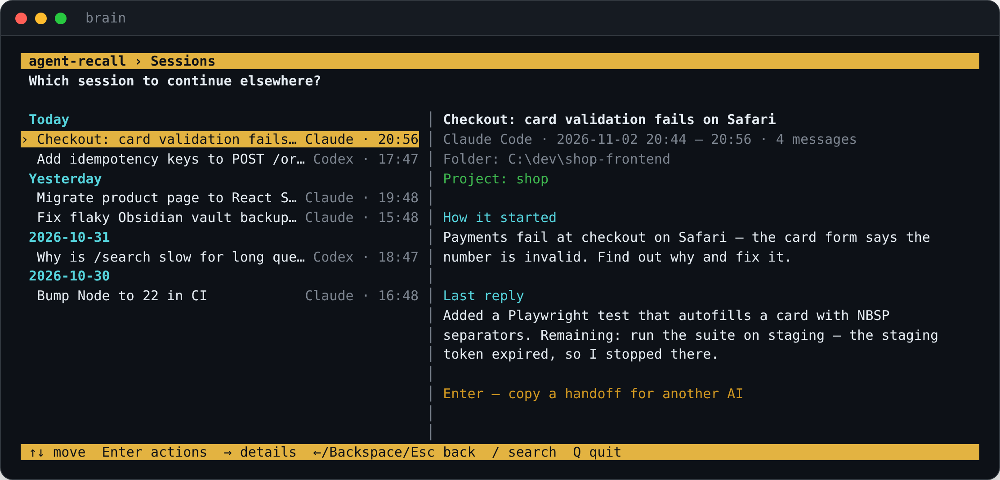

# agent-recall

**English** · [Русский](README.ru.md)

**Shared memory for your AI agents. Start a task in Claude Code, continue it in Codex — or any AI —
without explaining everything again.** agent-recall keeps every agent session, your Obsidian notes and
GitHub history in one local SQLite file, lets agents search it over MCP, and turns any session into a
handoff another AI can pick up.

[](https://github.com/Dakirchik/agent-recall/actions/workflows/ci.yml)
[](LICENSE)




## Why

Every agent keeps its own history, in its own folder, for a limited time (Claude Code deletes sessions
after 30 days by default). Switch tools and the new one knows nothing; come back next week and you
explain the context again.

- **Continue anywhere.** Pick a session, press Enter — a Markdown briefing (the task, files changed,
  commands run, where it stopped) lands in your clipboard. Paste it into Codex, Claude, ChatGPT,
  Gemini — anything.
- **Agents that remember.** Over MCP, Claude Code, Codex and Cline search your past sessions, notes and
  commits themselves: *"what did we decide about auth last week?"*
- **Nothing to run, nothing to pay.** No embeddings, no vector database, no server, no cloud. SQLite
  full-text search in one file you own, synced every 15 minutes in the background.

## Features

- **Full-screen terminal UI** (`brain`): sessions grouped by day with a details panel — how it started,
  the last reply, folder, project; search; recent items; project timelines; sync, import, agent
  connections and language — all from one menu. Every action also exists as a command.
- **Sources**: Claude Code, Codex CLI, Obsidian (notes, screenshots and PDFs), GitHub, and the Claude
  app / ChatGPT through their official data export.
- **Handoff** of one session or of a whole project (ADRs, notes, recent sessions, commits).
- **Projects** by rules — working folder, repo, note path, tags, Jira keys, keywords — with timelines.
- **MCP server** with `search`, `get_thread`, `timeline`, `handoff` and more, registered in one click.
- **One-command install on Windows, macOS and Linux**: Python if missing, a private environment,
  background sync (Task Scheduler, launchd, systemd or cron), `brainctl` to manage it all.
- **English and Russian** everywhere — UI, CLI, installer, handoffs.
- **Careful with your data**: secrets are masked before writing, deleted notes are kept, other tools'
  configs are backed up before any change, exports are consistent even during a sync.

## Install

The same thing on every system: a one-command installer finds Python 3.11+, creates a private
environment (your system Python is untouched), finds your Obsidian vaults and agent folders, runs the
first sync, schedules one every 15 minutes, connects the MCP server to the agents you have, and puts
`brain` and `brainctl` on PATH.

**Windows** — download the repository and double-click **`install.cmd`**, or in PowerShell:

```powershell
git clone https://github.com/Dakirchik/agent-recall; cd agent-recall
.\brainctl.ps1 install           # -Interval 30  -Vault "D:\Notes"  -Yes  -NoMcp
```

**macOS** — double-click **`install.command`** in Finder, or in Terminal:

```bash
git clone https://github.com/Dakirchik/agent-recall && cd agent-recall
./install.sh                      # --interval 30  --vault ~/Notes  --lang en  -y  --no-mcp
```

**Linux:**

```bash
git clone https://github.com/Dakirchik/agent-recall && cd agent-recall
./install.sh                      # same options; --python /usr/bin/python3.12 to pick one
```

| | Windows | macOS | Linux |
|---|---|---|---|
| Python 3.11+ if missing | installs 3.12 via winget | offers `brew install python@3.12` | prints the `apt` / `dnf` / `pacman` command |
| Program | `%LOCALAPPDATA%\agent-recall` | `~/.local/share/agent-recall` | `~/.local/share/agent-recall` |
| Commands | `brain`, `brainctl` on the user PATH | `~/.local/bin`, line in `~/.zshrc` | `~/.local/bin`, line in your shell profile |
| Sync every 15 min | Task Scheduler | launchd agent | systemd user timer, or cron |
| Data | `%USERPROFILE%\.agent-recall` | `~/.agent-recall` | `~/.agent-recall` |

Behind a corporate proxy set `HTTPS_PROXY` first. On **macOS**, if your Obsidian vault is in
Documents, Desktop or iCloud Drive, give the Python that the installer prints *Full Disk Access*
(System Settings → Privacy & Security), or the background sync cannot read it. On **Linux** the
systemd timer runs while you are logged in; `loginctl enable-linger $USER` makes it run without a
session too.

**GitHub (optional):** `gh auth login`, or set `GITHUB_TOKEN` to a read-only fine-grained token.

**Just pip** (any OS, no scheduler, no PATH changes): `pip install ".[mcp]"`, then
`brain init && brain sync -v && brain integrate add all`.

## Quick start

```bash
brain                                   # full-screen UI
brain handoff --last -c                 # latest session of any agent → clipboard
brain handoff payment validator -c      # find a session by words (all must match)
brain handoff --project shop -c         # briefing for a whole project
brain search checkout bug --since 2026-10-01
brain timeline shop
brain import auto Downloads/export.zip  # Claude app or ChatGPT data export
brain paths                             # where everything lives
```

## Managing it: brainctl

The same commands on every system (`brainctl.ps1` on Windows, `brainctl.sh` on macOS and Linux):

```bash
brainctl status                  # install, schedule, sources, agents
brainctl paths                   # all paths
brainctl config                  # open config.toml
brainctl log follow              # tail the sync log
brainctl task add --interval 30  # change the schedule (Windows: -Interval 30)
brainctl task pause | resume | run | remove
brainctl mcp add claude          # all | claude | codex | cline
brainctl update                  # git pull + reinstall
brainctl uninstall [--purge]     # --purge also deletes the database and config (Windows: -Purge)
```

Uninstall removes exactly what was added: the program folder, the commands, the scheduled job and the
PATH line in your profile. Settings of other tools (`.codex/config.toml`, Cline) are backed up as
`*.bak-<date>` before any change.

## What gets collected

| Source | What | How "new" is detected |
|---|---|---|
| **Claude Code** | your messages and replies, tool calls (clipped), folder, git branch, session summaries | byte offset per file |
| **Codex CLI** | messages and tool calls from `sessions` and `archived_sessions` | byte offset per file |
| **Obsidian** | notes with frontmatter, tags, links; ADRs and session logs as their own kinds | mtime + size; deleted notes are flagged, never erased |
| **Obsidian attachments** | screenshots, images, PDFs: copied next to the database, searchable by the text around where they are embedded, PDFs by content | same |
| **GitHub** | your commits, issues, PRs and comments | `since` per repository |
| **Claude app, ChatGPT** | chats from the official export, imported by hand | message ids — re-import adds only new ones |

Not stored: model "thinking", images inside agent chats, context the IDE injects. Search skips tool output
(file reads, command logs) unless you ask for it with `--tools`.

## Handoff

```markdown
# Context to continue the work
This is a summary of my session in Claude Code. Read it, briefly restate how you understand the task
and where we stopped, then continue from there. If something is missing, ask instead of guessing.

## Session            topic, period, folder and branch, project
## How it started     your first request
## Files and commands files changed and read, commands run
## My follow-up requests
## Where we stopped   the last messages
```

It is built from the database — no LLM, no API key — and trimmed to a size limit by dropping the middle
of the conversation first. Agents with MCP get it as the `handoff` tool.

## Projects

```toml
[[projects]]
id = "shop"
name = "Online shop"
cwd = ["*shop-frontend*"]   # agent session folder
repo = ["me/shop-*"]        # GitHub repository
obsidian = ["Work/Shop/*"]  # note path in the vault
tags = ["shop"]             # Obsidian tag, nested ones too
jira = ["SHOP"]             # finds SHOP-123 in any text
keywords = ["checkout-service"]
```

One matching message brings the whole session into the project; screenshots join the projects of the
notes they are embedded in. After editing: `brain projects --rebuild`.

## MCP tools

`search`, `get_item`, `get_thread`, `timeline`, `recent`, `list_projects`, `handoff` — read-only.
Connect from the UI (**Agents**), with `brainctl mcp add`, or by hand:

```bash
claude mcp add brain --scope user -- python -m agent_recall mcp
```
```toml
# ~/.codex/config.toml
[mcp_servers.brain]
command = "python"
args = ["-m", "agent_recall", "mcp"]
```

Tip: add to `CLAUDE.md` / `AGENTS.md`: *"Before asking me about past decisions, search the brain MCP."*

## Export

```bash
brain export db D:/Backup/brain.db       # consistent copy, safe during a sync
brain export jsonl all.jsonl             # one JSON object per line: RAG, fine-tuning, any warehouse
```
Or automatically after every sync: `after_sync` and `daily_snapshots_dir` in `config.toml`.
To browse the file: [DB Browser for SQLite](https://sqlitebrowser.org/) (read-only) or Datasette.

## Language

English or Russian for the UI, commands, installer and handoffs. It follows the OS language; switch on
the home screen (**Language**), with `language = "en"` in `config.toml`, or `AGENT_RECALL_LANG=en`.

## Privacy

Found a security problem? Please report it privately — see [SECURITY.md](SECURITY.md).


- Everything stays on your computer unless you configure an export target.
- Token-, key- and password-looking strings are masked before writing — a heuristic, not a guarantee.
- The database holds your full agent conversations: keep it on an encrypted disk.
- Keep employer data out of a personal archive: use a separate config and database at work.

## FAQ

**Why no vector database?** Agents are good at keyword search: they rephrase, try synonyms and both
languages, then read what they find. BM25 over SQLite is instant, free and transparent. If you ever need
semantic search, [sqlite-vec](https://github.com/asg017/sqlite-vec) fits into the same file.

**Does it send anything anywhere?** No. It reads local files and, if you enable it, the GitHub API with
your token. Handoffs go to your clipboard; you decide where to paste them.

**Will it slow my machine down?** A sync reads only what was appended since the last run, so after the
first one it usually takes a few seconds (GitHub, if enabled, adds a few API calls).

**Upgrading from brainsync?** That was this project's name before 0.1.0. Run the installer again: it
removes the old scheduled task and environment and keeps using your existing database.

## Development

See [CONTRIBUTING.md](CONTRIBUTING.md) for the rules of the house.

```bash
pip install -e ".[mcp]" pytest
pytest
```

A new source is one file in `agent_recall/collectors/` with `sync(conn, cfg, log)` calling
`upsert_items()`, plus a line in `collectors/__init__.py`. Strings shown to people go through `_()`
(translations in `locales.py`, a test lists anything untranslated); the UI uses `T(en, ru)`.
The terminal UI engine (`tui.py`) is shared with [skillpantry](https://github.com/Dakirchik/skillpantry).

## License

[MIT](LICENSE)
