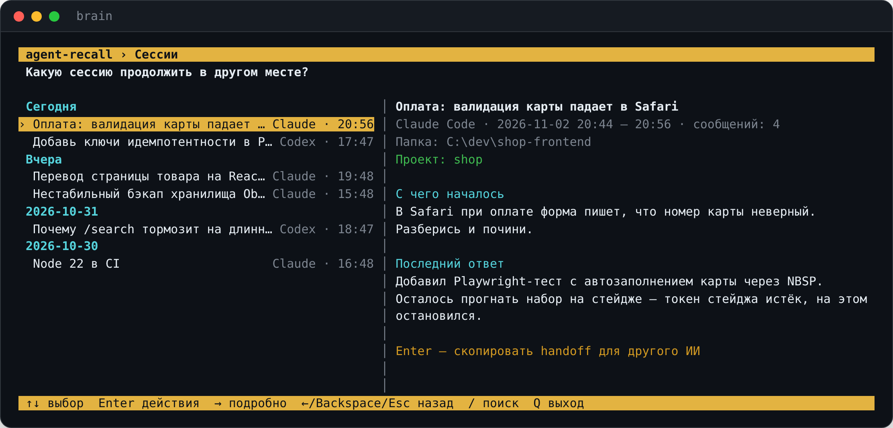

# agent-recall

[English](README.md) · **Русский**

**Общая память для ваших ИИ-агентов. Начните задачу в Claude Code и продолжите в Codex — или в любом
ИИ — без пересказа контекста.** agent-recall складывает все сессии агентов, заметки Obsidian и историю
GitHub в один локальный SQLite-файл, даёт агентам искать по нему через MCP и превращает любую сессию
в handoff, с которого продолжит другой ИИ.

[](https://github.com/Dakirchik/agent-recall/actions/workflows/ci.yml)
[](LICENSE)




## Зачем

Каждый агент хранит свою историю в своей папке и недолго (Claude Code по умолчанию удаляет сессии
через 30 дней). Переключились на другой инструмент — он ничего не знает; вернулись через неделю —
снова объясняете контекст.

- **Продолжить где угодно.** Выбрали сессию, нажали Enter — в буфере обмена выжимка в Markdown: задача,
  изменённые файлы, команды, где остановились. Вставьте в Codex, Claude, ChatGPT, Gemini — куда угодно.
- **Агенты, которые помнят.** Через MCP Claude Code, Codex и Cline сами ищут в ваших прошлых сессиях,
  заметках и коммитах: «что мы решили с авторизацией на прошлой неделе?»
- **Ничего не запускать и не оплачивать.** Без эмбеддингов, векторной базы, сервера и облака.
  Полнотекстовый поиск SQLite в одном вашем файле, синхронизация в фоне каждые 15 минут.

## Возможности

- **Полноэкранный интерфейс в терминале** (`brain`): сессии по дням с панелью подробностей — с чего
  началось, последний ответ, папка, проект; поиск; последнее; таймлайны проектов; синхронизация,
  импорт, подключение агентов и язык — всё из одного меню. У каждого действия есть и команда.
- **Источники**: Claude Code, Codex CLI, Obsidian (заметки, скриншоты и PDF), GitHub, а также
  приложение Claude и ChatGPT через их официальный экспорт данных.
- **Handoff** одной сессии или целого проекта (ADR, заметки, последние сессии, коммиты).
- **Проекты** по правилам — рабочая папка, репозиторий, путь заметки, теги, ключи Jira, слова — с таймлайнами.
- **MCP-сервер** с `search`, `get_thread`, `timeline`, `handoff` и другими, подключается в один клик.
- **Установка одной командой на Windows, macOS и Linux**: Python, если его нет, отдельное окружение,
  фоновая синхронизация (Планировщик задач, launchd, systemd или cron), `brainctl` для управления.
- **Английский и русский** везде — интерфейс, команды, установщик, выжимки.
- **Бережно к данным**: секреты маскируются до записи, удалённые заметки сохраняются, настройки других
  инструментов копируются перед изменением, выгрузка корректна даже во время синхронизации.

## Установка

На всех системах одинаково: установщик одной командой находит Python 3.11+, создаёт отдельное
окружение (системный Python не трогается), находит хранилища Obsidian и папки агентов, делает первую
синхронизацию, ставит её в расписание каждые 15 минут, подключает MCP к установленным агентам и
добавляет `brain` и `brainctl` в PATH.

**Windows** — скачайте репозиторий и дважды щёлкните **`install.cmd`**, или в PowerShell:

```powershell
git clone https://github.com/Dakirchik/agent-recall; cd agent-recall
.\brainctl.ps1 install           # -Interval 30  -Vault "D:\Notes"  -Yes  -NoMcp
```

**macOS** — дважды щёлкните **`install.command`** в Finder, или в Терминале:

```bash
git clone https://github.com/Dakirchik/agent-recall && cd agent-recall
./install.sh                      # --interval 30  --vault ~/Notes  --lang ru  -y  --no-mcp
```

**Linux:**

```bash
git clone https://github.com/Dakirchik/agent-recall && cd agent-recall
./install.sh                      # те же параметры; --python /usr/bin/python3.12 — выбрать Python
```

| | Windows | macOS | Linux |
|---|---|---|---|
| Python 3.11+, если нет | ставит 3.12 через winget | предложит `brew install python@3.12` | подскажет команду `apt` / `dnf` / `pacman` |
| Программа | `%LOCALAPPDATA%\agent-recall` | `~/.local/share/agent-recall` | `~/.local/share/agent-recall` |
| Команды | `brain`, `brainctl` в PATH пользователя | `~/.local/bin`, строка в `~/.zshrc` | `~/.local/bin`, строка в профиле оболочки |
| Синхронизация каждые 15 мин. | Планировщик задач | агент launchd | таймер systemd пользователя или cron |
| Данные | `%USERPROFILE%\.agent-recall` | `~/.agent-recall` | `~/.agent-recall` |

За корпоративным прокси сначала задайте `HTTPS_PROXY`. На **macOS**, если хранилище Obsidian лежит
в «Документах», на «Рабочем столе» или в iCloud Drive, дайте Python, который покажет установщик,
*Полный доступ к диску* (Системные настройки → Конфиденциальность и безопасность), иначе фоновая
синхронизация не сможет его прочитать. На **Linux** таймер systemd работает, пока вы вошли в систему;
`loginctl enable-linger $USER` — чтобы и без сеанса.

**GitHub (по желанию):** `gh auth login` или переменная `GITHUB_TOKEN` с токеном только на чтение.

**Просто через pip** (любая ОС, без расписания и правки PATH): `pip install ".[mcp]"`, затем
`brain init && brain sync -v && brain integrate add all`.

## Быстрый старт

```bash
brain                                   # полноэкранный интерфейс
brain handoff --last -c                 # последняя сессия любого агента → в буфер
brain handoff валидатор оплаты -c       # найти сессию по словам (совпасть должны все)
brain handoff --project shop -c         # выжимка по всему проекту
brain search ошибка оплаты --since 2026-10-01
brain timeline shop
brain import auto Downloads/export.zip  # экспорт приложения Claude или ChatGPT
brain paths                             # где что лежит
```

## Управление: brainctl

На всех системах одни и те же команды (`brainctl.ps1` на Windows, `brainctl.sh` на macOS и Linux):

```bash
brainctl status                  # установка, расписание, источники, агенты
brainctl paths                   # все пути
brainctl config                  # открыть config.toml
brainctl log follow              # следить за логом синхронизации
brainctl task add --interval 30  # поменять расписание (Windows: -Interval 30)
brainctl task pause | resume | run | remove
brainctl mcp add claude          # all | claude | codex | cline
brainctl update                  # git pull и переустановка
brainctl uninstall [--purge]     # --purge удалит ещё и базу с конфигом (Windows: -Purge)
```

Удаление убирает ровно то, что было добавлено: папку программы, команды, задачу расписания и строку
PATH в профиле. Настройки других инструментов (`.codex/config.toml`, Cline) перед изменением
копируются в `*.bak-<дата>`.

## Что собирается

| Источник | Что | Как определяется «новое» |
|---|---|---|
| **Claude Code** | ваши сообщения и ответы, вызовы инструментов (обрезанные), папка, ветка git, резюме сессий | байтовое смещение в файле |
| **Codex CLI** | сообщения и вызовы инструментов из `sessions` и `archived_sessions` | байтовое смещение в файле |
| **Obsidian** | заметки с frontmatter, тегами, ссылками; ADR и логи сессий — отдельные типы | время изменения и размер; удалённые помечаются, но не стираются |
| **Вложения Obsidian** | скриншоты, картинки, PDF: копируются рядом с базой, ищутся по тексту вокруг места вставки, PDF — по содержимому | то же |
| **GitHub** | ваши коммиты, issues, PR и комментарии | `since` по каждому репозиторию |
| **Приложение Claude, ChatGPT** | чаты из официального экспорта, вручную | id сообщений — повторный импорт добавит только новое |

Не сохраняется: «размышления» модели, картинки внутри чатов агентов, служебный контекст IDE. Поиск не
смотрит в вывод инструментов (прочитанные файлы, логи команд), если не попросить `--tools`.

## Handoff

```markdown
# Контекст для продолжения работы
Это выжимка моей сессии в Claude Code. Прочитай её, коротко перескажи, как ты понял задачу и где мы
остановились, и продолжай с этого места. Если чего-то не хватает — спроси, не додумывай.

## Сессия              тема, период, папка и ветка, проект
## С чего началось      ваш первый запрос
## Файлы и команды      изменённые и прочитанные файлы, команды
## Мои следующие запросы
## Где остановились     последние реплики
```

Собирается из базы — без LLM и API-ключей — и укладывается в лимит размера: первой сокращается
середина разговора. Агентам с MCP доступна как инструмент `handoff`.

## Проекты

```toml
[[projects]]
id = "shop"
name = "Интернет-магазин"
cwd = ["*shop-frontend*"]   # папка сессии агента
repo = ["me/shop-*"]        # репозиторий GitHub
obsidian = ["Work/Shop/*"]  # путь заметки в хранилище
tags = ["shop"]             # тег Obsidian, и вложенные тоже
jira = ["SHOP"]             # найдёт SHOP-123 в любом тексте
keywords = ["checkout-service"]
```

Одно совпавшее сообщение приводит в проект всю сессию; скриншоты попадают в проекты заметок, куда они
вставлены. После правки: `brain projects --rebuild`.

## Инструменты MCP

`search`, `get_item`, `get_thread`, `timeline`, `recent`, `list_projects`, `handoff` — только чтение.
Подключаются из интерфейса (**Агенты**), через `brainctl mcp add` или вручную:

```bash
claude mcp add brain --scope user -- python -m agent_recall mcp
```
```toml
# ~/.codex/config.toml
[mcp_servers.brain]
command = "python"
args = ["-m", "agent_recall", "mcp"]
```

Совет: добавьте в `CLAUDE.md` / `AGENTS.md` строку «Прежде чем спрашивать меня о прошлых решениях,
поищи в MCP brain».

## Выгрузка

```bash
brain export db D:/Backup/brain.db       # консистентная копия, безопасно во время синхронизации
brain export jsonl all.jsonl             # по строке JSON на запись: RAG, дообучение, любое хранилище
```
Или автоматически после каждой синхронизации: `after_sync` и `daily_snapshots_dir` в `config.toml`.
Посмотреть файл: [DB Browser for SQLite](https://sqlitebrowser.org/) (только чтение) или Datasette.

## Язык

Английский или русский — интерфейс, команды, установщик и выжимки. По умолчанию — язык системы;
переключить можно на главном экране (**Язык**), строкой `language = "ru"` в `config.toml` или
переменной `AGENT_RECALL_LANG=ru`.

## Приватность

Нашли проблему с безопасностью? Сообщите приватно — см. [SECURITY.md](SECURITY.md).


- Всё остаётся на вашем компьютере, если вы сами не настроили выгрузку.
- Похожие на токены, ключи и пароли строки маскируются до записи — эвристика, а не гарантия.
- В базе — ваша полная переписка с агентами: держите её на зашифрованном диске.
- Не смешивайте данные работодателя с личным архивом: на работе — отдельный конфиг и база.

## Вопросы

**Почему без векторной базы?** Агенты хорошо ищут по словам: перебирают формулировки, синонимы и оба
языка, потом читают найденное. BM25 поверх SQLite мгновенный, бесплатный и прозрачный. Если понадобится
семантический поиск, [sqlite-vec](https://github.com/asg017/sqlite-vec) встраивается в тот же файл.

**Отправляет ли он что-то куда-то?** Нет. Читает локальные файлы и, если включить, API GitHub с вашим
токеном. Выжимки идут в ваш буфер обмена — куда вставлять, решаете вы.

**Не будет ли тормозить компьютер?** Синхронизация читает только то, что дописалось с прошлого раза,
поэтому после первой обычно занимает несколько секунд (GitHub, если включён, добавляет пару запросов к API).

**Обновляетесь с brainsync?** Так проект назывался до 0.1.0. Запустите установщик ещё раз: он уберёт
старую задачу и окружение и продолжит работать с вашей базой.

## Разработка

Правила — в [CONTRIBUTING.md](CONTRIBUTING.md).

```bash
pip install -e ".[mcp]" pytest
pytest
```

Новый источник — файл в `agent_recall/collectors/` с функцией `sync(conn, cfg, log)`, которая вызывает
`upsert_items()`, и строка в `collectors/__init__.py`. Тексты для людей — через `_()` (переводы в
`locales.py`, тест покажет непереведённое); интерфейс использует `T(en, ru)`. Движок интерфейса
(`tui.py`) общий со [skillpantry](https://github.com/Dakirchik/skillpantry).

## Лицензия

[MIT](LICENSE)
